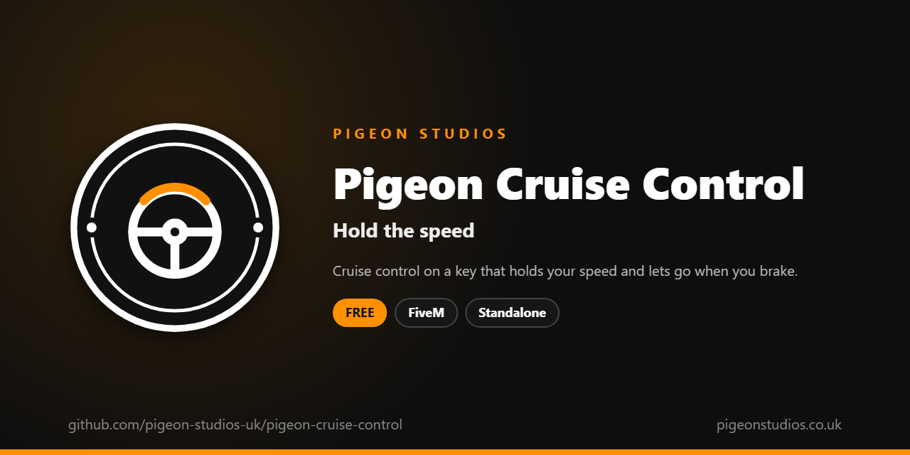

<div align="center">
  

  <h1>Pigeon Cruise Control</h1>

  <p><strong>Cruise control on a key that holds your speed, caps it downhill, and lets go when you brake.</strong></p>

  <p>
    <a href="https://github.com/pigeon-studios-uk/pigeon-cruise-control/releases/latest"></a>
    <a href="LICENSE.md"></a>
    <a href="https://discord.gg/2NFVWEUmDF"></a>
    
  </p>

  <p>
    <a href="https://github.com/pigeon-studios-uk/pigeon-cruise-control/releases/latest"><strong>Download</strong></a> ·
    <a href="#installation">Install</a> ·
    <a href="#configuration">Configure</a> ·
    <a href="CHANGELOG.md">Changelog</a> ·
    <a href="https://discord.gg/2NFVWEUmDF">Support</a>
  </p>
</div>

---

## Contents

- [Overview](#overview)
- [Features](#features)
- [Requirements](#requirements)
- [Installation](#installation)
- [Updating](#updating)
- [Configuration](#configuration)
- [Localisation](#localisation)
- [Commands and exports](#commands-and-exports)
- [How it works](#how-it-works)
- [Update checker](#update-checker)
- [Performance](#performance)
- [Security](#security)
- [Troubleshooting](#troubleshooting)
- [FAQ](#faq)
- [Support](#support)
- [Contributing](#contributing)
- [Licence](#licence)
- [Credits](#credits)

## Overview

Pigeon Cruise Control is a free resource by [Pigeon Studios](https://pigeonstudios.co.uk) that gives drivers cruise control. Long patrols, convoys, motorway runs and roleplay at the speed limit are easier when you don't have to hold the accelerator and watch the speedometer the whole way.

Get up to speed and press Y. The vehicle holds that speed, uphill and down, until you brake, pull the handbrake, crash or press Y again. Players can raise and lower the set speed with keys they choose, and it doesn't work in boats, aircraft, bicycles or trains.

## Features

- **One key.** Y by default, which players can change in GTA's key bindings, or `/cruise`.
- **Holds the speed both ways.** It accelerates up to the set speed and caps the vehicle there, so it doesn't run away downhill.
- **Lets go like a real one.** Braking, the handbrake, a crash, the engine stopping or leaving the seat turn it off.
- **Faster and slower.** `/cruiseup` and `/cruisedown`, or keys players pick, change the speed in steps.
- **mph or km/h.** For the messages, the minimum speed and the steps.
- **Only where it makes sense.** Not in boats, helicopters, planes, bicycles or trains, and not in reverse.
- **For other resources.** Exports to check the set speed or turn it off.
- **23 languages.** Follows ox_lib's language, or set your own.
- **Standalone.** No framework or other resources needed.

## Requirements

| Requirement | Version | Notes |
|---|---|---|
| FXServer | A [recommended artifact](https://runtime.fivem.net/artifacts/) | |
| [ox_lib](https://github.com/communityox/ox_lib) | Optional | Used for messages and the language if it's running |

**Frameworks:** none needed. It works the same on standalone and vMenu servers, ESX Legacy, QBCore, Qbox and ox_core.

## Installation

1. **Download** `pigeon-cruise-control.zip` from the [latest release](https://github.com/pigeon-studios-uk/pigeon-cruise-control/releases/latest). Don't use the green **Code** button; release zips are the tested builds.
2. **Extract** it into your server's `resources` folder. The folder must be called `pigeon-cruise-control`.
3. **Start it** by adding this to `server.cfg`, after ox_lib if you use it:

   ```cfg
   ensure pigeon-cruise-control
   ```

4. **Configure** it in `configuration/config.lua` if you want to change anything. The defaults work as they are.
5. **Restart** your server. The console shows one line from the update checker:

   ```text
   [Pigeon Studios] Pigeon Cruise Control v1.0.0 is up to date.
   ```

## Updating

1. Read the [changelog](CHANGELOG.md) for every version between yours and the latest, especially any **Upgrade notes**.
2. Back up your `configuration/` and `locales/` folders.
3. Replace the `pigeon-cruise-control` folder with the new release.
4. Copy your changed settings into the new `configuration/config.lua`. Don't copy the old file over the new one; new versions can add settings.
5. Restart the resource.

## Configuration

All settings are in `configuration/config.lua`, each explained by a comment next to it.

| Setting | Default | What it does |
|---|---|---|
| `Config.Locale` | `'auto'` | The language. `'auto'` follows ox_lib's; or a code such as `'de'` (see [Localisation](#localisation)) |
| `Config.Key` | `'Y'` | The default key to turn it on and off. Players can change it in GTA's key bindings |
| `Config.Command` | `'cruise'` | The command, which the key runs. The faster and slower commands are this with `up` and `down` on the end |
| `Config.UpKey` | `''` | The default key for faster. `''` leaves it unbound until a player picks one |
| `Config.DownKey` | `''` | The default key for slower. `''` leaves it unbound until a player picks one |
| `Config.Step` | `5` | How much each faster or slower press changes the speed, in `Config.Units` |
| `Config.Units` | `'mph'` | `'mph'` or `'kmh'` |
| `Config.MinSpeed` | `20` | The slowest speed it can be set at, in `Config.Units` |
| `Config.BlockedClasses` | `{ 13, 14, 15, 16, 21 }` | Vehicle classes it doesn't work in: cycles, boats, helicopters, planes and trains |
| `Config.ShowMessages` | `true` | Tell players when it turns on or off, and why it can't |
| `Config.Notifications` | `'auto'` | `'auto'` (ox_lib if it's running), `'ox_lib'` or `'gta'` |

## Localisation

Pigeon Cruise Control comes in 23 languages: `en` English, `cs` Czech, `da` Danish, `de` German, `es` Spanish, `et` Estonian, `fi` Finnish, `fr` French, `hr` Croatian, `hu` Hungarian, `id` Indonesian, `it` Italian, `nl` Dutch, `no` Norwegian, `pl` Polish, `pt` Portuguese, `pt-br` Brazilian Portuguese, `ro` Romanian, `sl` Slovenian, `sv` Swedish, `tr` Turkish, `zh-cn` Simplified Chinese and `zh-tw` Traditional Chinese. They're the languages ox_lib ships, so your server may already have one set.

With `Config.Locale = 'auto'` (the default), it uses ox_lib's language, so one line in `server.cfg` sets it for this and every other resource that follows ox_lib:

```cfg
setr ox:locale "de"
```

Use `setr`, not `set`, so players' games get it too. Without it, or for a language that isn't in `locales/`, the text is English. To choose a language for this resource only, set `Config.Locale` to its code, such as `'fr'` or `'pt-br'`.

The key binding names in GTA's settings are set the first time a player joins, in the language the server had then. Chinese text can show as blank in GTA's own text, such as its notifications, because GTA only loads its Chinese font when the game itself is set to Chinese. ox_lib's notifications show every language.

Every file was checked for missing text and placeholders, but not every translation has been read by a native speaker yet. If something reads wrong, please send a fix; see [Contributing](#contributing). To add a language, copy `locales/en.lua` to a new file named with the language's code (such as `ja.lua`), change `Locales.en` at the top to match (`Locales.ja`), and translate the text in quotes.

## Commands and exports

### Commands

| Command | Who | What it does |
|---|---|---|
| `/cruise` | Drivers | Turn cruise control on at the current speed, or off. The Y key runs it |
| `/cruiseup` | Drivers | While it's on, go faster by `Config.Step` |
| `/cruisedown` | Drivers | While it's on, go slower by `Config.Step`, down to `Config.MinSpeed` |

The commands change with `Config.Command`: with `'cc'`, they're `/cc`, `/ccup` and `/ccdown`.

### Exports

Client exports, for other resources in the player's game:

```lua
-- True while cruise control is on.
local on = exports['pigeon-cruise-control']:IsCruising()

-- The set speed in metres per second, or nil while it's off. Multiply by 2.237 for mph or 3.6 for km/h.
local speed = exports['pigeon-cruise-control']:GetCruiseSpeed()

-- Turn it off, for example when another resource takes over the vehicle.
exports['pigeon-cruise-control']:Cancel()
```

## How it works

When the driver presses the key, the resource checks they're in the driver's seat of a vehicle that isn't in `Config.BlockedClasses`, with the engine running, going forwards at `Config.MinSpeed` or more. It rounds the speed to a whole mph or km/h and sets that as the vehicle's top speed (`SetEntityMaxSpeed`), so it can't go faster, even downhill.

Then every frame, while the vehicle is below the set speed and on all four wheels, it holds the accelerator down for the driver (`SetControlNormal`), gently as it gets close so it doesn't surge past. It's turned off, and the top speed is put back, when the driver brakes or pulls the handbrake, the vehicle hits something, the engine stops, the driver leaves the seat, or they press the key again.

Raising and lowering the set speed moves the top speed with it. Everything happens in the driver's own game, on their own vehicle, so it's synced the way all driving is.

## Update checker

When it starts, Pigeon Cruise Control checks our public [version registry](https://github.com/pigeon-studios-uk/pigeon-versions) once and prints one line in the server console saying whether it's up to date. If there's an update, it shows what's new and where to get it. The check is a single request to GitHub and sends nothing about your server or players.

Control it for every Pigeon Studios resource at once in `server.cfg`:

```cfg
set pigeon_update_check "on"      # default: one line per resource
set pigeon_update_check "quiet"   # only when there's an update or a problem
set pigeon_update_check "off"     # never check
```

## Performance

Nothing runs while it's off, apart from the key bindings. While it's on, it reads the vehicle's speed and a few controls each frame, which costs next to nothing. Nothing runs on the server apart from the update check at start-up.

## Security

- It runs only in each driver's own game and only changes the vehicle they're driving.
- It has no network events, so there is nothing other players or the server can send it. The exports can only be called by resources in the player's own game.
- It can't make a vehicle faster than it already goes: it only holds the accelerator and lowers the top speed.
- The only network request is the update check at start-up, from the server to GitHub. It sends nothing about your server or players.

Found a problem? Please don't open a public issue. Use the **Report a vulnerability** button in this repository's **Security** tab, or follow our [Security Policy](https://github.com/pigeon-studios-uk/.github/blob/main/SECURITY.md).

## Troubleshooting

**Nothing happens when I press Y.**
Check the key in **Settings → Key Bindings → FiveM → Cruise control on / off**; if another resource uses Y, change one of them. You need to be the driver, going forwards at `Config.MinSpeed` or more, with the engine on. With `Config.ShowMessages`, a message says why.

**It turns off by itself.**
Touching anything with the body of the vehicle counts as a crash and turns it off, as do braking and the handbrake. Some controllers press the brake slightly when resting; check the trigger's dead zone.

**My speed limiter stops working after cruise control.**
Cruise control sets the vehicle's top speed while it's on, and takes the cap away when it's off, so it replaces a top speed another resource set. Have the limiter set its cap again after `IsCruising()` turns false, or use one of the two.

**It goes slower than the set speed uphill.**
It holds the accelerator fully down below the set speed, so a vehicle that can't keep up on a steep hill slows down, as it would with the pedal down.

**The text is in the wrong language.**
Check `setr ox:locale` in `server.cfg` (with `setr`, not `set`), or set `Config.Locale` to the language's code.

**The console says "isn't in the version registry" or "couldn't check for updates".**
Your server couldn't reach GitHub, or the check is blocked by a firewall. The resource works normally either way. Turn the check off with `set pigeon_update_check "off"`.

## FAQ

**Is it really free?**
Yes. Use it on as many servers as you like, including ones that take donations. You just can't reupload, resell or bundle it. See [Licence](#licence).

**Does it work on standalone and vMenu servers?**
Yes. It needs no framework at all, and works alongside vMenu.

**Can I go faster to overtake?**
Press faster (`/cruiseup` or your key) a few times, or turn it off, overtake and set it again.

**Does it work on motorbikes?**
Yes. Only bicycles, boats, aircraft and trains are left out by default; change `Config.BlockedClasses` to suit.

**Does it work with my speedometer HUD?**
Yes. It doesn't draw anything of its own. HUDs can show it with the `IsCruising` and `GetCruiseSpeed` exports.

## Support

Read [Troubleshooting](#troubleshooting) first, then ask in the support channels of our [Discord](https://discord.gg/2NFVWEUmDF). Please include your Pigeon Cruise Control version, FXServer artifact and any errors from the console (F8 in game). See [Getting help](https://github.com/pigeon-studios-uk/.github/blob/main/SUPPORT.md).

Found a bug? Open a [bug report](https://github.com/pigeon-studios-uk/pigeon-cruise-control/issues/new/choose).

## Contributing

Fixes, improvements and translations are welcome. Please read the [contributing guide](https://github.com/pigeon-studios-uk/.github/blob/main/CONTRIBUTING.md) first, and open a feature request before working on anything big.

## Licence

Pigeon Cruise Control is free to use under the **[Pigeon Studios Free Licence](LICENSE.md)**.

- ✅ Use it on any number of servers, including monetised ones
- ✅ Change it for your own servers
- ✅ Show it in videos and streams
- ❌ Don't reupload, share or mirror the files; link to this repository instead
- ❌ Don't sell it, bundle it in packs, or put it behind escrow
- ❌ Don't remove the credits

This summary isn't the licence; [LICENSE.md](LICENSE.md) is. Third-party components are listed in [NOTICE.md](NOTICE.md).

## Credits

Made by [Pigeon Studios](https://pigeonstudios.co.uk). Thanks to everyone who has contributed fixes and translations; see the [changelog](CHANGELOG.md).

<sub>Not affiliated with or endorsed by Rockstar Games, Take-Two Interactive or Cfx.re.</sub>
